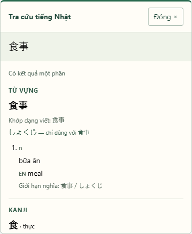

# F-03/F-04 Verification — 2026-10-11

Branch: feat/selection-popup-stale-protection.
F-02 prerequisite merged and pushed to origin/dev at
e01ee19d2458403d3dc9d9a18df0ffc4e0426dc4; remote SHA verified.

F-03/F-04 implementation, tests and documentation were normally pushed to
origin/feat/selection-popup-stale-protection at 86cd930c1e05bbc8c68a590b452a63d2d3f5e8df,
verified equal to local HEAD. Implementation commit: 99c2634; test commit: 18035fa.
This was the initial feature-branch delivery. The local dev merge b3d187d passed
post-merge gates on 2026-10-12; remote delivery is tracked by
[PR #10](https://github.com/vup568/extension_dict/pull/10), as dev requires a pull request.

## Recorded results (browser/coverage 2026-10-11; backend rerun 2026-10-12)

| Gate | Result |
|---|---|
| Strict TypeScript | PASS |
| Extension Vitest | PASS — 223/223 in 14 files |
| Node coverage | statements 96.74%; branches 93.58%; functions 98.24%; lines 97.85% |
| Unicode generated policy | PASS — 25 ranges, pinned SHA-256 verified |
| Production build | PASS — library dist/index.js plus Chromium/Firefox bundles/manifests |
| Dependency audit | PASS — zero findings after source-map-js 1.2.2 exact override |
| Full browser suite | PASS — 112/112, skipped 0, unexpected 0, flaky 0 |
| Chrome | PASS — 37/37, including 16 F-01/F-02 regressions and 21 popup tests |
| Edge | PASS — 37/37, including 16 F-01/F-02 regressions and 21 popup tests |
| Brave | PASS — 37/37, including 16 F-01/F-02 regressions and 21 popup tests |
| Packaged Chromium MV3 | PASS — 1/1 on installed Brave, actual content/background transport |
| .NET Release solution build | PASS — 0 warnings, 0 errors |
| .NET unit regression | PASS — 53/53 on 2026-10-12 |
| PostgreSQL integration rerun | PASS — 51/51 on 2026-10-12, PostgreSQL 16 Testcontainers |
| Firefox runtime | PENDING — compatible executable unavailable |
| Approved PERF-001 benchmark | PENDING — shell before dispatch verified, no approved p95 certification claimed |

Full browser report timestamp: 2026-10-11T16:31:47.908Z (23:31:47 Asia/Saigon),
duration 56006.504 ms. Ignored raw runner output: extension/test-results/browser-results.json.
The full report is archived in browser-results-full.json beside this document.
Raw output is regenerated by the documented commands.

## What was exercised

- Exact ruby-safe selection before classification; no Japanese, annotation-only and collapsed
  ranges send no request. Oversized selection shows a clear non-truncating failure.
- Loading is committed before transport. Rapid selection debounce is 300 ms.
- New selection invalidates old identity before debounce, attempts abort, and rejects late
  success/error/partial even when cancellation is ignored. Same text and Retry get fresh UUIDs.
- Independent hard 5 s deadline; timeout and Close cannot be reopened by old outcomes.
- API validator matches actual mixed DTO naming and checks nested content, version and correlation.
- Vocabulary language/restrictions, kanji provenance and repeated grammar occurrences remain visible;
  completed-empty, failed, unavailable and partial states stay distinct.
- Shadow styling, viewport/scroll, transformed host, nested open-shadow focus return,
  popup-owned selection and BFCache lifecycle are covered by browser assertions.
- No selection logs/storage/history/navigation; backend permission/fetch origin bounded,
  cookies omitted and sender/tab/frame cancellation isolation verified.

## Packaged Extension boundary

Smoke test loads the real dist/chromium manifest and bundled files in a temporary local
Brave profile. A normal insecure http://jp-host.test page has ruby selection without a
test harness. The actual Extension service worker POSTs to a controlled localhost backend
fixture, exactly {text: "食事", interaction_id: UUID}. No cookie or page context is sent.
This proves packaging/permissions/background transport. The backend fixture supplies the
existing API DTO contract; it is not a live PostgreSQL-backed deployment test or evidence
for packaged Chrome/Edge/Firefox execution.

## Review fixes

Independent review identified and implementation corrected BFCache listener teardown,
visualViewport height, transformed-host positioning, open-shadow focus restoration,
popup-interaction suppression and UUID availability on ordinary HTTP pages. Machine error
codes are allowlisted, avoiding raw provider content in errors. The existing committed
default DB connection string was removed; runtime requires environment configuration.
No remaining P1/P2 finding was reported after the full browser run.

## Limitations and final polish

Firefox build is available but not an inferred runtime pass. Docker startup failed at
dockerInference socket during the 2026-10-11 run; the issue was resolved by 2026-10-12,
when the PostgreSQL Testcontainers suite passed 51/51 on the merged tree.
Closed host shadow-root focus remains opaque. Input/textarea non-Range selection is unsupported.
Existing linguistic data/segmentation/deinflection limits remain described in README.

Final visual polish explicitly aligns header controls and sets dir=ltr; default Vite
also processes Tailwind so test harness and packaged UI use the same pipeline.
Targeted revalidation after this polish: PASS 19/19 (6 Chrome, 6 Edge, 6 Brave,
1 packaged MV3 smoke), no skipped/failing cases. Production build and strict typecheck
passed again. Header horizontal layout and explicit LTR direction have browser assertions.
The synthetic preview was refreshed and inspected. Packaged smoke uses configured or
locally available browser discovery, never a hardcoded user path or browser download.

Typecheck covers runtime browser/application code, unit and browser tests. The Node-only
packaged smoke runs through Playwright and is execution-verified; it is excluded from the
browser tsconfig because @types/node is not an approved installed dependency. An optional
broader typecheck exposed missing Node definitions, so the existing boundary was retained
without adding packages or bypassing any runtime type error.

